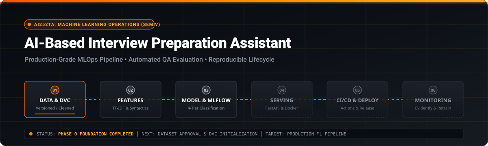
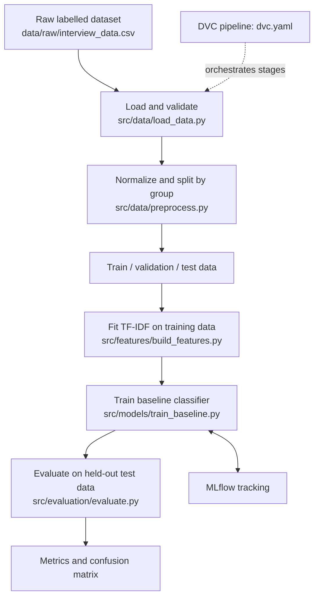

<div align="center">



# AI-Based Interview Preparation Assistant

### A reproducible MLOps foundation for interview-answer quality classification

**Data validation → Preprocessing → TF-IDF features → Baseline training → Evaluation**

[](https://www.python.org/)
[](https://dvc.org/)
[](https://mlflow.org/)
[](https://scikit-learn.org/)
[](https://github.com/Tejzraj/MLOps)
[](https://sdgs.un.org/goals/goal4)
[](https://sdgs.un.org/goals/goal8)

</div>

---

## Project overview

The **AI-Based Interview Preparation Assistant** is a machine-learning project designed to help candidates practise technical and behavioural interview questions. Its planned model takes an interview question and a candidate's answer, predicts an answer-quality category, and can later support useful feedback.

This repository focuses on the **MLOps lifecycle** behind that model: data validation, reproducible preprocessing, leakage-aware feature building, baseline model training, evaluation, and experiment tracking.

> [!IMPORTANT]
> **Current status:** The Phase 1 code and automated test foundation have been implemented. The test suite and DVC pipeline graph have been checked, but a compatible, labelled dataset is not yet available at `data/raw/interview_data.csv`. Therefore, a complete real-data `dvc repro`, real model training, and held-out evaluation have **not** yet been demonstrated. No model-performance numbers are claimed.

## Current milestone

| Component | Status | Evidence / next action |
|---|---|---|
| Project structure and environment | Complete | `pyproject.toml`, `requirements.txt`, `Makefile` |
| Dataset schema and annotation rubric | Documented | `docs/dataset/` |
| Data validation and loading | Implemented; unit-tested | `src/data/validation.py`, `src/data/load_data.py` |
| Preprocessing and grouped data splits | Implemented; unit-tested | `src/data/preprocess.py` |
| TF-IDF feature pipeline | Implemented; unit-tested | `src/features/build_features.py` |
| Baseline training with MLflow logging | Implemented; unit-tested | `src/models/train_baseline.py` |
| Evaluation and report generation | Implemented; unit-tested | `src/evaluation/evaluate.py` |
| DVC pipeline definition | Defined; `dvc dag` checked | `dvc.yaml` |
| Automated tests and code-quality checks | Reported passing in the latest development check | Commands below |
| Real-data end-to-end reproduction | **Pending** | Obtain a compatible, appropriately licensed labelled dataset |
| API, Docker, CI/CD, monitoring | Planned | Later project phases |

For the detailed status, see [`docs/PROJECT_STATUS.md`](docs/PROJECT_STATUS.md). The latest source audit is in [`docs/dataset/CS_FUNDAMENTALS_SOURCE_AUDIT.md`](docs/dataset/CS_FUNDAMENTALS_SOURCE_AUDIT.md), and the reproduction notes are in [`docs/reproducibility/REPRODUCIBILITY.md`](docs/reproducibility/REPRODUCIBILITY.md).

## ML problem

**Inputs:** an interview question and a candidate's written answer.  
**Target:** a four-class answer-quality label.

| Label | Category | General interpretation |
|---:|---|---|
| 0 | Poor | Incorrect, irrelevant, or incoherent response |
| 1 | Needs Improvement | Partially relevant response missing important concepts |
| 2 | Good | Mostly correct and clearly explained response |
| 3 | Excellent | Detailed, accurate response that may explain trade-offs and edge cases |

These definitions are an annotation rubric, not a claim that the model has already learned or validated these categories. Final labels require suitable candidate responses and a consistent annotation process.

### Important data requirement

A question-and-reference-answer collection alone is **not** enough to train this supervised classifier. Training requires candidate responses paired with defensible quality labels. Do not substitute reference answers for candidate answers or invent labels merely to make the pipeline run.

The intended dataset schema is documented in [`docs/dataset/DATASET_SPECIFICATION.md`](docs/dataset/DATASET_SPECIFICATION.md). Feature construction should use the question and candidate-answer text; target labels, scores, and other label-derived fields must not leak into the model inputs. Data splits should keep related examples grouped by question to reduce leakage.

## Pipeline architecture



The intended split is **70% train / 10% validation / 20% test**, with grouping by question ID. The vectorizer must be fitted on training data only. The test set is reserved for final evaluation rather than model selection.

## Technology stack

| Technology | Purpose |
|---|---|
| Python | Pipeline implementation |
| Pandas / NumPy | Tabular data processing |
| scikit-learn | TF-IDF and baseline classifiers |
| DVC | Pipeline orchestration and data/artifact versioning |
| MLflow | Experiment parameters, metrics, and artifact tracking |
| pytest | Automated tests |
| Ruff / Black | Linting and formatting |
| FastAPI / Docker / GitHub Actions | Planned serving and delivery work |
| Evidently / Prometheus / Grafana | Planned monitoring and observability |

## Quickstart

### 1. Clone and set up the environment

```bash
git clone https://github.com/Tejzraj/MLOps.git
cd MLOps

python3 -m venv .venv
source .venv/bin/activate

python -m pip install --upgrade pip
pip install -r requirements.txt
pip install -r requirements-dev.txt
```

If your local `.venv` is already configured, activate it instead of recreating it.

### 2. Run the automated tests

The tests use test fixtures and are intended to run without the real interview dataset.

```bash
python -m pytest tests/
```

### 3. Run code-quality checks

```bash
ruff check src/ tests/
black --check src/ tests/
git diff --check
```

### 4. Inspect the DVC pipeline

```bash
dvc dag
```

This displays the pipeline dependency graph. It does not prove that the pipeline has completed successfully on a real dataset.

### 5. Run the end-to-end pipeline

First place a **compatible, appropriately licensed and labelled** dataset at:

```text
data/raw/interview_data.csv
```

The file must satisfy the required schema in [`docs/dataset/DATASET_SPECIFICATION.md`](docs/dataset/DATASET_SPECIFICATION.md), including candidate answers and quality labels.

Then run:

```bash
dvc repro
```

Until that input exists, `dvc repro` is expected to stop at the data-loading stage. This is a missing-input condition, not a successful end-to-end reproduction.

### 6. Open MLflow

```bash
mlflow ui --port 5000
```

Then visit `http://localhost:5000`. Actual runs and metrics will be visible only after a pipeline execution logs them to the configured tracking store.

## Repository map

```text
MLOps/
├── configs/                 # Runtime and tracking configuration
├── data/
│   ├── raw/                  # Required source dataset (not included)
│   ├── interim/              # Loaded intermediate data
│   └── processed/            # Train / validation / test splits
├── docs/
│   ├── dataset/              # Schema, annotation rubric, source audit
│   ├── reproducibility/      # Reproduction notes
│   └── PROJECT_STATUS.md     # Current project status
├── models/                   # Generated vectorizer and model artifacts
├── notebooks/                # Exploratory analysis notebooks
├── reports/                  # Generated metrics and audit reports
├── src/
│   ├── data/                 # Loading, validation, preprocessing
│   ├── features/             # Feature construction
│   ├── models/               # Baseline training
│   ├── evaluation/           # Held-out evaluation
│   └── utils/                # Shared configuration and utilities
├── tests/                    # Automated test suite
├── dvc.yaml                  # DVC stage definitions
├── params.yaml               # Pipeline parameters
└── pyproject.toml             # Tool and test configuration
```

## Roadmap

- [x] Define the project structure, dataset schema, and quality rubric
- [x] Implement the data-processing, feature, training, and evaluation code
- [x] Add automated tests and define the DVC pipeline
- [ ] Acquire or curate a permitted, labelled candidate-response dataset
- [ ] Validate dataset quality, label consistency, and group splits
- [ ] Run the complete pipeline on real data and record actual metrics
- [ ] Compare baseline models and document error analysis
- [ ] Add an inference API and containerization
- [ ] Add CI/CD automation
- [ ] Add monitoring, drift analysis, and governance documentation

Progress should be updated only when a milestone has evidence. Unit tests validate code behaviour on test fixtures; they do not replace a real-data training and evaluation run.

## Responsible data use

- Use datasets whose licences and reuse permissions permit the intended use.
- Do not redistribute third-party materials without permission.
- Remove personal identifiers and confidential information from candidate responses.
- Record dataset provenance and annotation methodology.
- Evaluate whether writing style, language fluency, or dialect may unfairly affect scores.
- Treat predicted quality as practice feedback, not as a definitive measure of a person's ability or employability.

## Academic context

- **Course:** AI252TA — Machine Learning Operations
- **Semester:** V
- **UN SDG 4:** Quality Education — supports accessible interview practice and learning.
- **UN SDG 8:** Decent Work and Economic Growth — aims to help candidates practise job-interview skills.

## Maintainer

Maintained by [Tejzraj](https://github.com/Tejzraj). See [`CONTRIBUTING.md`](CONTRIBUTING.md) for contribution guidance.
